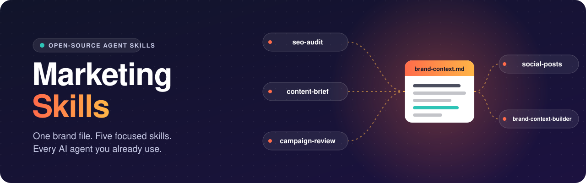
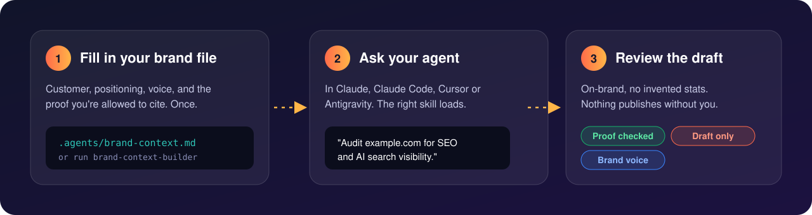

<p align="center">
  
</p>

<p align="center">
  <a href="LICENSE"></a>
  <a href="https://agentskills.io/specification"></a>
  
  
</p>

<p align="center">
  <a href="#install"><b>Install</b></a> ·
  <a href="#the-skills"><b>Skills</b></a> ·
  <a href="#how-it-works"><b>How it works</b></a> ·
  <a href="examples/brand-context-example.md"><b>Example</b></a> ·
  <a href="#contributing"><b>Contribute</b></a>
</p>

---

A small, focused pack of marketing skills for AI agents. Write your company facts **once**,
then use the same skills in Claude, Claude Code, Cursor, Google Antigravity and any tool
that supports the open [Agent Skills](https://agentskills.io/specification) format.

> **Why only five?** Large packs with overlapping skills make agents pick the wrong one or
> skip skills entirely. Every skill here does one job no other skill covers. More will
> follow once these prove themselves.

## The skills

<table>
  <tr>
    <td width="72" align="center"></td>
    <td><a href=".agents/skills/brand-context-builder/SKILL.md"><b>brand-context-builder</b></a><br>Interviews you and fills in <code>brand-context.md</code>, the one file every other skill reads.</td>
  </tr>
  <tr>
    <td align="center"></td>
    <td><a href=".agents/skills/seo-audit/SKILL.md"><b>seo-audit</b></a><br>Technical SEO, on-page, structured data and AI search visibility, with a ranked fix list.</td>
  </tr>
  <tr>
    <td align="center"></td>
    <td><a href=".agents/skills/content-brief/SKILL.md"><b>content-brief</b></a><br>Writer-ready briefs: search intent, angle, outline, proof points and SEO details.</td>
  </tr>
  <tr>
    <td align="center"></td>
    <td><a href=".agents/skills/social-posts/SKILL.md"><b>social-posts</b></a><br>Platform-native posts, threads, carousels and short video scripts in your voice.</td>
  </tr>
  <tr>
    <td align="center"></td>
    <td><a href=".agents/skills/campaign-review/SKILL.md"><b>campaign-review</b></a><br>Pre-launch check for unsupported claims, compliance risks, voice and tracking gaps.</td>
  </tr>
</table>

## How it works

<p align="center">
  
</p>

Every skill reads `.agents/brand-context.md` before it writes. Facts live in that one file;
the skills hold only the method. That gives you two guarantees:

- 🛡️ **No invented proof.** Skills may only cite numbers, testimonials and logos listed in
  the "Approved proof and claims" section. Anything else is flagged `[UNVERIFIED - NEEDS SOURCE]`.
- ✋ **Drafts only.** Skills write and review. They never publish, send, schedule, launch or
  change ad spend on their own.

```
.agents/
├── brand-context.md        ← your company facts, voice and approved proof
└── skills/
    ├── brand-context-builder/
    ├── seo-audit/
    ├── content-brief/
    ├── social-posts/
    └── campaign-review/
```

See [`examples/brand-context-example.md`](examples/brand-context-example.md) for a filled-in
example (a fictional company).

## Install

### Claude Code (plugin)

Install everything in one step:

```
/plugin install marketing-skills --marketplace ElMoorish/marketing-skills
```

Or add the marketplace first, then install:

```
/plugin marketplace add ElMoorish/marketing-skills
/plugin install marketing-skills@marketing-skills
```

Skills then show up as `/marketing-skills:seo-audit`, `/marketing-skills:social-posts` and so
on, and Claude also picks them automatically when a task matches. Put your
`brand-context.md` in your project's `.agents/` folder.

<details>
<summary>Prefer plain files instead of a plugin?</summary>

Claude Code loads skills from `.claude/skills/`. Copy them in:

```bash
python3 scripts/build.py --install /path/to/your/project
cp .agents/brand-context.md /path/to/your/project/.agents/brand-context.md
```

Or copy them to `~/.claude/skills/` to use them in every project.
</details>

### Claude (claude.ai and the desktop app)

1. Download the ZIPs from the latest [release](../../releases), or build them yourself:
   ```bash
   python3 scripts/build.py      # writes dist/<skill>.zip
   ```
2. In Claude, go to **Settings > Capabilities**, make sure code execution is on, and upload
   each ZIP under **Skills**. (Menu names can change; see Anthropic's
   [custom skills guide](https://support.claude.com/en/articles/12512198-how-to-create-custom-skills).)
3. Fill in [`.agents/brand-context.md`](.agents/brand-context.md) (or ask Claude to run
   `brand-context-builder`) and add it to your Claude Project's knowledge.

### Cursor and Google Antigravity

Both read skills from `.agents/skills/` in your workspace. Copy the `.agents/` folder into
your project and fill in `brand-context.md`:

```bash
cp -r .agents /path/to/your/project/
```

### Other tools

Any tool that supports the Agent Skills format can use the folders in `.agents/skills/`
as they are. Check your tool's docs for where it looks for skills. `AGENTS.md`, `CLAUDE.md`
and `GEMINI.md` at the repo root tell agents to read the brand context first.

## Quick start

1. Install the skills for your tool (above).
2. Ask: *"Build our brand context. Our site is example.com."*
3. Then try:
   - *"Run an SEO audit on example.com/pricing."*
   - *"Write a content brief for 'bookkeeping for agencies'."*
   - *"Turn this blog post into LinkedIn and X posts."*
   - *"Review this launch email before we send it."*

## Compatibility notes

These limits were checked against current docs in November 2026:

| Rule | Source |
|---|---|
| Frontmatter keys `name` and `description` required; `license`, `compatibility`, `metadata`, `allowed-tools` optional | [Agent Skills spec](https://agentskills.io/specification) |
| `name`: up to 64 chars, lowercase letters, digits and hyphens, must match the folder | Agent Skills spec |
| `description`: up to 1,024 chars in the spec, but **200 chars** for claude.ai uploads | Agent Skills spec; [Claude help center](https://support.claude.com/en/articles/12512198-how-to-create-custom-skills) |
| Names can't contain "anthropic" or "claude"; no XML tags | [Claude docs](https://platform.claude.com/docs/en/agents-and-tools/agent-skills/overview) |
| Keep SKILL.md under 500 lines; move detail to `references/` | Agent Skills spec; Claude best practices |
| Upload ZIP must contain the skill folder at its root | Claude help center |
| Claude Code plugins can point `skills` at a custom folder | [Claude Code plugins reference](https://code.claude.com/docs/en/plugins-reference) |

To stay portable, every skill here uses only `name`, `description`, `license` and
`metadata`, keeps descriptions at 200 characters or less, and avoids tool-specific syntax.
`scripts/build.py` checks all of this.

## Contributing

Ideas and fixes are welcome. Before opening a pull request:

1. Keep each skill focused on one job that no other skill covers.
2. Put company facts in `brand-context.md`, never in a skill.
3. Run the validator:
   ```bash
   python3 scripts/build.py --check
   ```

The build script uses only the Python standard library (3.8+).

## Roadmap

Candidates for the next skills: copywriting with an anti-slop editing pass, competitor
intelligence, customer research synthesis, lifecycle email, CRO experiments, and analytics
reporting. Optional per-tool safety hooks (for example, blocking publish or ad-spend
actions) may ship as separate adapters, kept out of the core skills.

## License

[MIT](LICENSE) © Ayman (ElMoorish) and contributors
